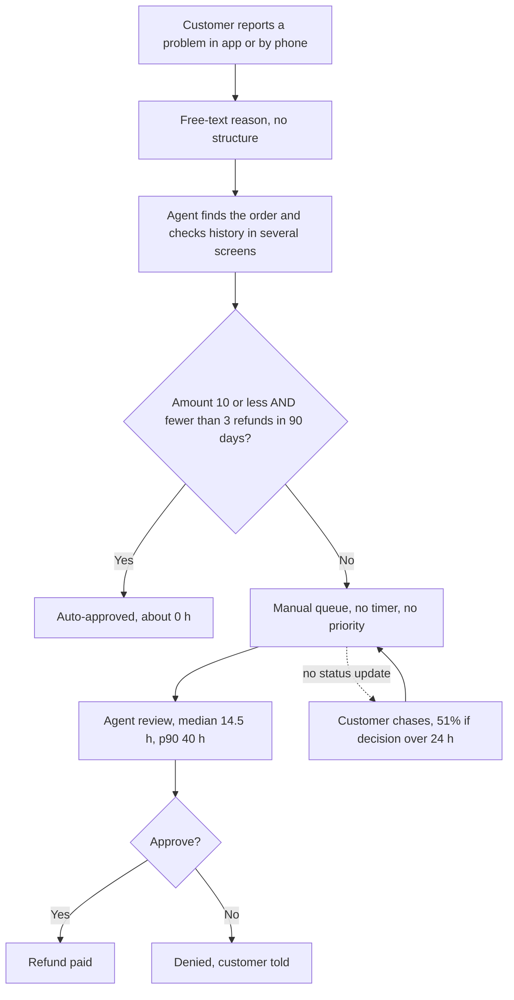
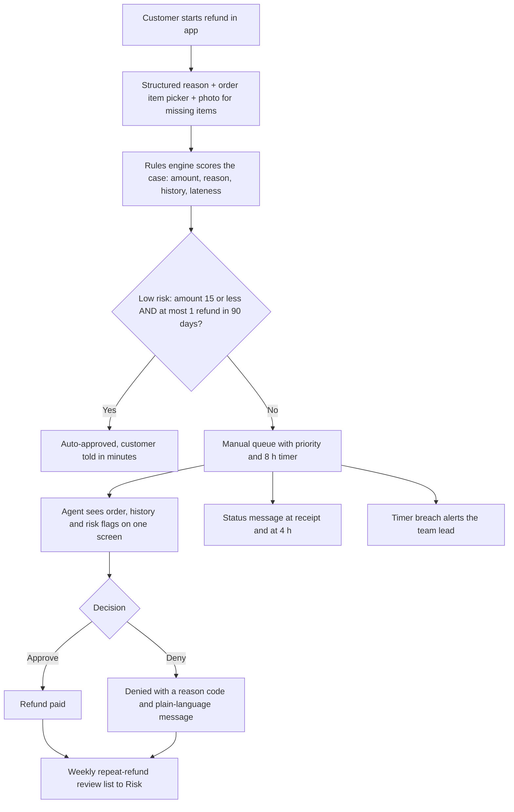
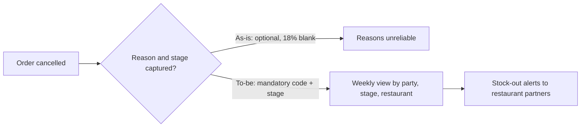

# 3. Process: as-is and to-be

Diagrams are Mermaid (render on GitHub).

## As-is: refund request

### Pain points (with evidence)
| # | Pain point | Evidence |
|---|---|---|
| P1 | 60% of refund cases go to manual review | 375 of 623 cases |
| P2 | Slow decisions with no timer | Median 14.5 h; 23% over 24 h |
| P3 | Customers chase because there is no status | 51% chase when over 24 h vs 17% under |
| P4 | Reason is free text, so it cannot be analysed reliably | Reasons must be inferred |
| P5 | Repeat claimants are found only by manual lookup | 42 customers with 3 or more refunds |
| P6 | Cancellation reason and stage are not enforced | 18% of cancellations have no reason |

## To-be: refund request

### What changes
| Area | As-is | To-be | Addresses |
|---|---|---|---|
| Intake | Free text | Structured reason, item picker, photo for missing items | P4 |
| Auto-approval | 10 limit, fewer than 3 refunds | 15 limit, at most 1 prior refund (pilot) | P1 |
| Queue | No timer or priority | 8 h target, priority by age and value, lead alert | P2 |
| Customer communication | Silence | Receipt and 4 h status messages | P3 |
| Risk monitoring | Manual lookup | Weekly repeat-refund list | P5 |

## As-is and to-be: cancellations

Cancellations after food is prepared or on the way (68% of cancellations) are the costly ones. The to-be process makes them visible so partnerships and operations can act on them; this case does not model a savings figure for that.
