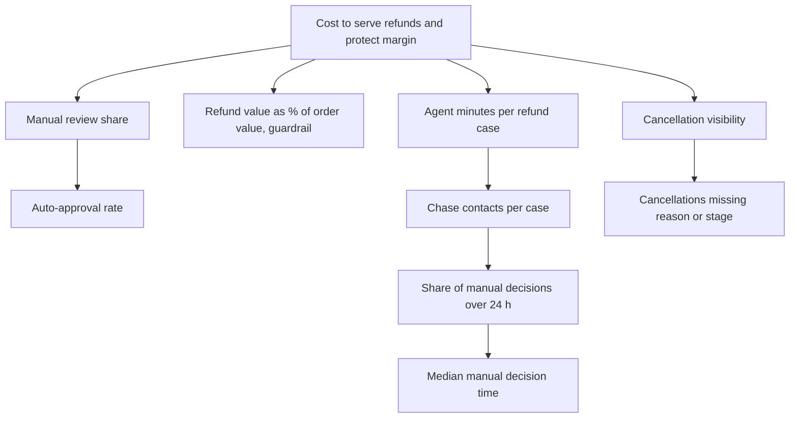

# 7. KPIs and benefits case

Everything here is computed from the synthetic six-month sample (10,000 orders) by `scripts/analyse.py`. Cost parameters are assumptions you can change. Targets are proposals.

## KPI tree

## KPI definitions
| KPI | Definition | Baseline | Proposed target | Owner |
|---|---|---|---|---|
| Manual review share | Refund cases not auto-approved / all refund cases | 60% | 40% or less | Support |
| Median manual decision time | Median hours from request to decision, manual cases | 14.5 h | 8 h or less | Support |
| Manual decisions over 24 h | Share of manual cases decided after 24 h | 23% | under 5% | Support |
| Chase rate (over 24 h) | Share of cases over 24 h where the customer contacts again | 51% | under 20% | Support |
| Refund value % of order value | Refunds paid / order value | 2.28% | at most baseline + 0.2 pts (guardrail) | Finance |
| Agent hours per 100 refund cases | Agent minutes / 60 / cases x 100 | 31.9 | about 20% lower | Support |
| Cancellations missing reason | Cancelled orders with no reason code / all cancelled | 18% | under 2% | Operations |

## Levers tested on the data
### Lever 1: risk-based auto-approval (recommended for pilot)
Move cases from manual to automatic by raising the amount limit and tightening the history rule. "Leak" is the value of refunds that manual review denied in the moved cases, assuming all would now be paid (a ceiling).

| Rule (limit, max prior refunds in 90 d) | Cases moved | % of manual | Denied by manual review | Leak ceiling | Agent cost saved | Net |
|---|---|---|---|---|---|---|
| Today: 10, 2 | 0 | 0% | 0 | 0 | 0 | 0 |
| 15, 2 | 130 | 35% | 23 | 283 | 803 | +520 |
| **15, 1** | **122** | **33%** | **19** | **232** | **766** | **+534** |
| 20, 2 | 183 | 49% | 32 | 437 | 1,087 | +650 |
| 20, 1 | 172 | 46% | 27 | 369 | 1,032 | +663 |

**Recommendation:** pilot 15 with at most 1 prior refund. It gives up about 5% of the saving (766 vs 803) in exchange for about 18% less leakage (232 vs 283) than 15 with 2 prior refunds. The 20-limit options earn more but carry the most risk; revisit after the pilot.
Worst case for the guardrail: refund value rises from 2.28% to about 2.37% of order value, inside the +0.2 point limit.

### Lever 2: decide within 24 hours (supports lever 1)
87 manual cases took over 24 hours and generated 99 chase contacts. If those cases behaved like the under-24-hour cases, chase contacts would fall to about 34, saving about 130 in agent cost. The larger value is customer experience. This overlaps with lever 1 (moved cases also avoid chasing), so **the two are not added together**.

### Lever 3: proactive credit for very late orders (not recommended)
A fixed credit of 3 for 556 orders that were more than 20 minutes late costs 1,668. Even if it prevented 75% of the 50 late-delivery refund cases, it would avoid only about 677 in refunds and handling.

| Scenario | Cases avoided | Credits cost | Cost avoided | Net |
|---|---|---|---|---|
| Conservative | 25% | 1,668 | 226 | -1,442 |
| Base | 50% | 1,668 | 451 | -1,217 |
| Optimistic | 75% | 1,668 | 677 | -991 |

Net is negative in every scenario. Retention and satisfaction effects are not modelled, so this is a cost case only. The cheaper alternative is a message without a credit (FR-13), which can be tested in the pilot.

## Benefit summary (six-month, 10,000-order sample)
Recommended rule: about 38 agent hours saved (766 in agent cost), 70 fewer chase contacts, and up to 232 of added refund value. Net about +534, or about **+53 per 1,000 orders**. Multiply by real order volume to size the benefit.

## Sensitivity
| Assumption changed | Effect on the recommended rule |
|---|---|
| Agent cost 15 / 20 / 30 per hour | Saving 575 / 766 / 1,149; net +343 / +534 / +917 |
| Leakage twice the ceiling (abusers exploit the new limit) | Leak 464; net +302 |
| Break-even | Net stays positive until leakage is 3.3 times the ceiling, or agent cost falls below about 6 per hour |

## Not modelled
Customer retention and satisfaction effects; cost of building the rules and timers; cost of reviewing the weekly repeat-claimant list; the value of reducing cancellations after food is prepared (the case makes the problem visible and does not claim a saving).
