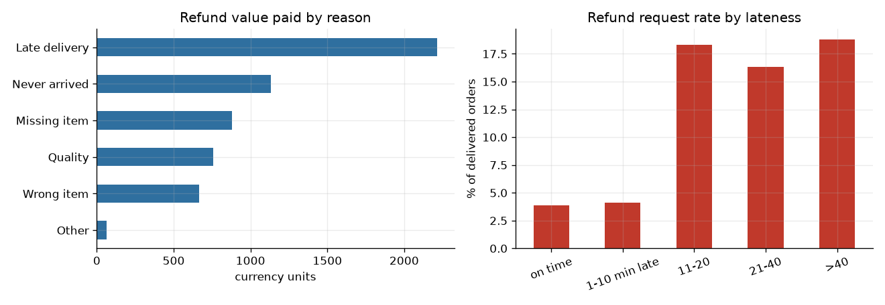
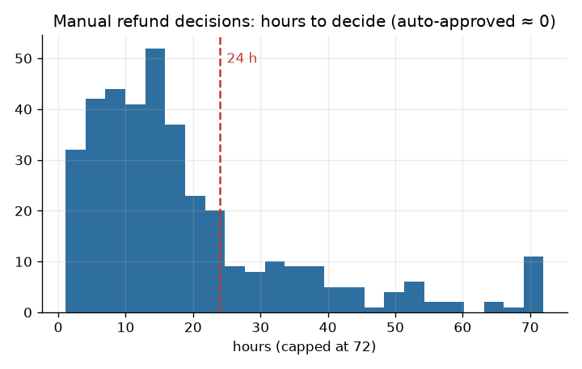
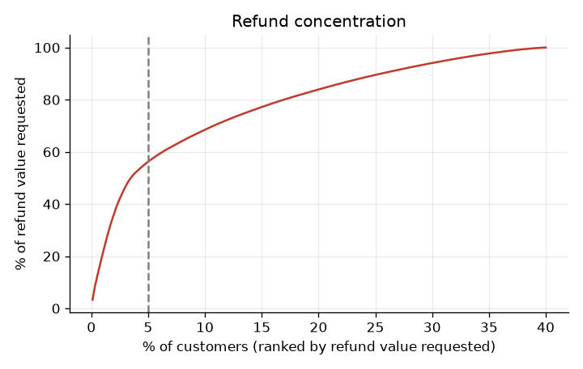
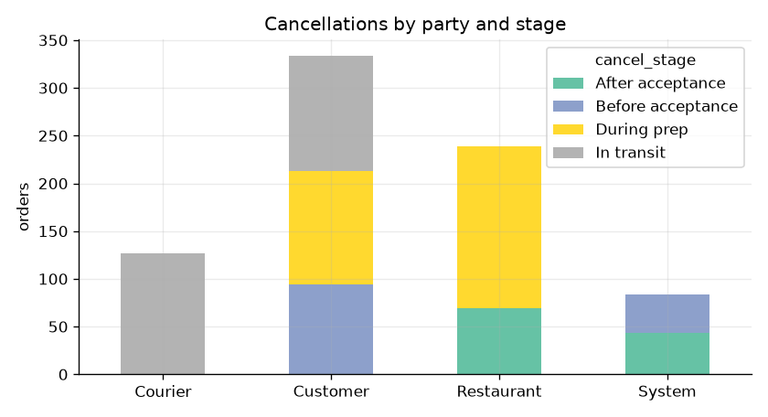

# 9. Baseline analysis

**Synthetic data**: 10,000 orders over six months (Jan-Jun 2025), generated by `scripts/generate_orders.py`. Numbers come from `scripts/analyse.py` (`analysis/results.json`). Planted patterns are listed in `assumptions_and_data.md`, so these results show how I would analyse the problem, not discoveries.

## Headline numbers
| Measure | Value |
|---|---|
| Orders / delivered / cancelled | 10,000 / 9,216 / 784 (7.8%) |
| Refund cases | 623 (6.8% of delivered) |
| Refund value paid | 5,718 (2.28% of order value, which totals 251,232) |
| Auto-approved / manual-approved / manual-denied | 248 / 229 / 146 |
| Manual share | 60% (375 of 623); 39% of manual cases denied |
| Manual decision time | median 14.5 h, p90 40.4 h, 23% over 24 h |
| Chase contacts | 51% when a manual decision took over 24 h; 17% when under 24 h |
| Agent effort on refunds | 199 hours (about 3,980 at the assumed 20 per hour) |

## Refunds by reason (value paid)
| Reason | Cases | Paid | Share |
|---|---|---|---|
| Late delivery | 203 | 2,215 | 39% |
| Never arrived | 100 | 1,131 | 20% |
| Missing item | 178 | 880 | 15% |
| Quality | 77 | 758 | 13% |
| Wrong item | 54 | 668 | 12% |
| Other | 11 | 66 | 1% |

Late delivery is the biggest driver. The refund request rate jumps once an order is more than 10 minutes late (18% vs about 4% on time), and stays about the same beyond that:

| Lateness | Refund request rate |
|---|---|
| On time | 3.9% |
| 1-10 minutes late | 4.1% |
| 11-20 minutes | 18.3% |
| 21-40 minutes | 16.3% |
| Over 40 minutes | 18.8% |

20.2% of delivered orders were more than 10 minutes late. A fixed credit for lateness does not pay back (see `07_kpis_and_benefits_case.md`), because most late customers do not ask for refunds.

## Manual review is slow

## Concentration
The top 5% of customers (45 of 900) account for 41% of refund requests and **56% of the value requested**; 42 customers made 3 or more requests. Concentration does not prove abuse, since some customers order more often, but it justifies a weekly review list and a history rule.

## Cancellations
| Cancelled by | Orders | Food cost lost (assumed 60% if prepared) |
|---|---|---|
| Customer | 334 | 3,635 |
| Restaurant | 239 | 2,460 |
| Courier | 127 | 2,012 |
| System | 84 | 0 |

68% of cancellations happen after food is being prepared or is on the way, with about 8,100 in assumed lost food cost. A quarter of restaurant cancellations are "item out of stock". 18% of cancellations have no reason code.

## What the analysis does not say
- It does not prove which refunds were legitimate: "denied" means manual review decided against it.
- The 60% food-loss share and the 20-per-hour agent cost are assumptions.
- It is a six-month sample; real seasonality, promotions and restaurant mix are not represented.
